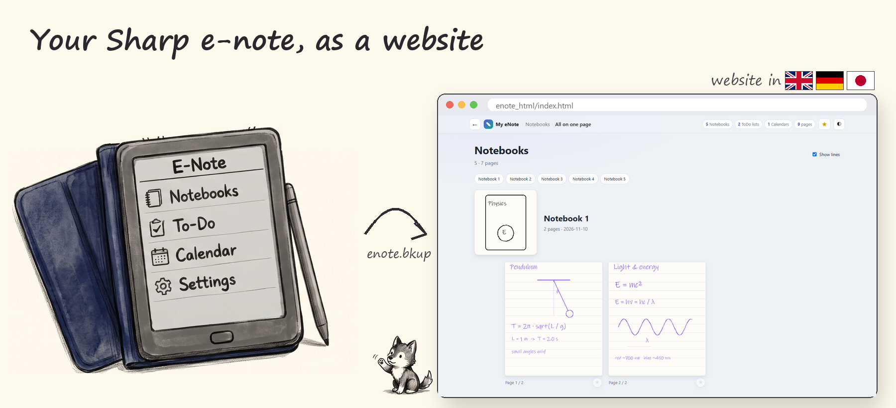
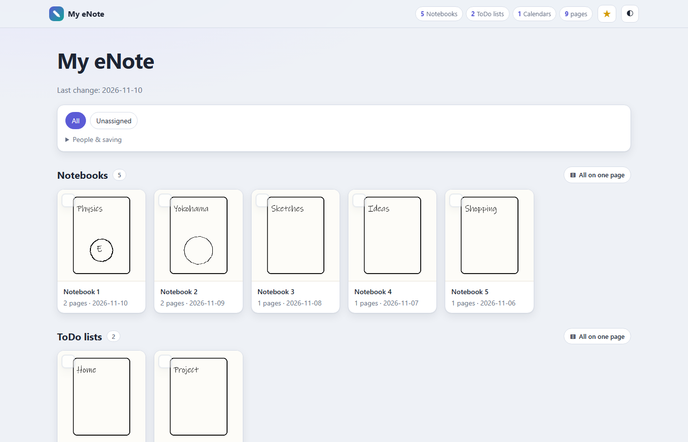
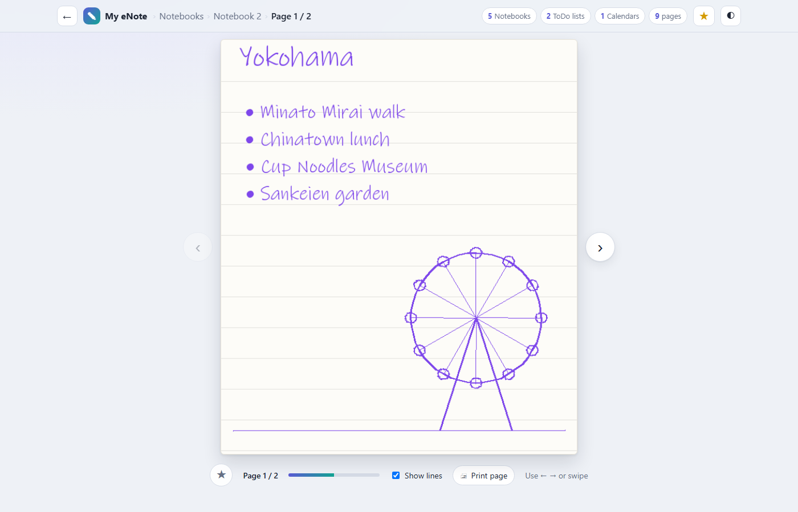
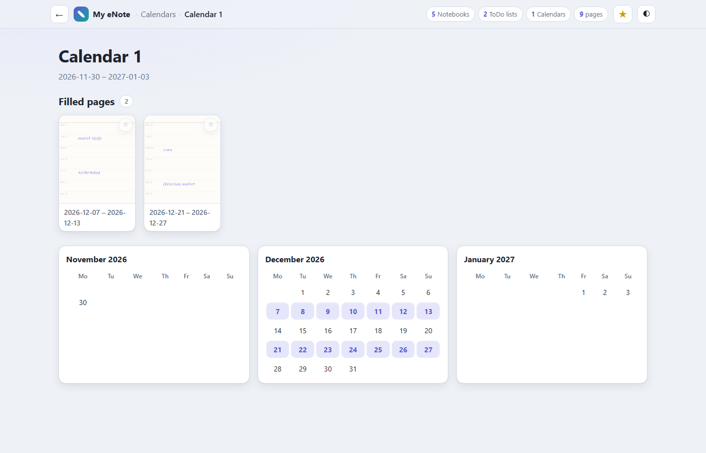
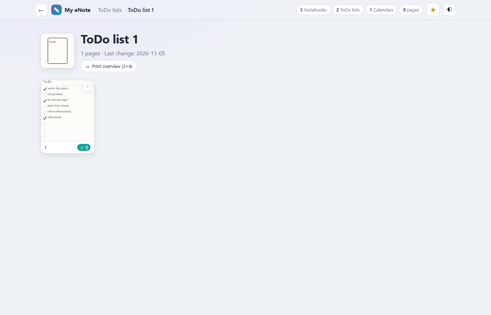

# eNote viewer (chicraccoon) – your Sharp e-note as a website



Turns the backup of a **Sharp electronic notebook** (電子ノート, WG-PN1 / WG-S20 / WG-S30) into a
website you open in any browser, plus **PDFs** of every notebook, ToDo list and calendar.
Runs on your own computer, nothing is uploaded. Interface in **English · Deutsch · 日本語**.

[Quick start](#quick-start) · [What you get](#what-you-get) · [Try the demo](#try-it-without-a-device) ·
[日本語](#日本語) · [Deutsch](#deutsch) · [For developers](#for-developers)

## Why this exists

My first e-note, a **WG-S20**, was a present from a great physics professor from Italy who lives in
Yokohama. I liked it a lot, bought a **WG-PN1** and filled notebooks and more. Sharp's own utility was
limited; [Aleksejs Popovs' chicraccoon](https://github.com/aleksejspopovs/chicraccoon) already had most
of it, but didn't work with the PN1. I fixed that and added a few UI improvements here and there
(marking favourites, printing, PDFs, three languages, …).

## Quick start

| | |
|---|---|
| **1. Backup** | On the e-note: *Settings → Backup*. Connect it by USB (it shows up like a USB stick) and copy `BACKUP/enote.bkup` to your computer. |
| **2. Python** (once) | Install from [python.org](https://www.python.org/downloads/). Windows: tick **“Add python.exe to PATH”**. |
| **3. Download** | Green **Code** button → **Download ZIP** → unzip. |
| **4. Start** | Double-click **`START_Windows.bat`** (Mac/Linux: `START_macOS_Linux.command`). |
| **5. Go** | Choose your `enote.bkup`, pick a language, press **Start**. |

Your notes open in the browser; the PDFs are in the folder next to them. Next time: new backup, press
Start again – only changed pages are converted.

## What you get

| Home: all notebooks, ToDo lists and calendars | Page viewer (← → keys, swipe, print) |
|---|---|
|  |  |
| **Calendars** with the filled weeks | **ToDo lists** with ticks |
|  |  |

- **All on one page:** every notebook / ToDo list / calendar below each other – scroll through everything.
- **Favourites ★:** star pages (Shift+click stars a whole range), see them on one page.
- **Print:** a single page centred on A4, or a whole book as an overview with 3×4 pages per sheet.
- **PDFs:** one file per notebook, ToDo list and calendar (calendars: only pages with writing).
- **Owners:** shared device? Assign books to people and filter by person.
- **Light / dark** theme, works straight from disk (no server).

## Try it without a device

```
python -m pip install -r requirements.txt
python demo/make_demo.py            # -> demo/demo_site/index.html
```

The demo notes (physics, a Yokohama trip, a wolf cub sketch, …) are made up and drawn by the script.

## 日本語

シャープ電子ノート（WG-PN1 / WG-S20 / WG-S30）のバックアップを、ブラウザで見られるウェブサイトとPDFに変換します。
すべて自分のパソコン上で動き、何もアップロードされません。

1. 電子ノートの設定で「バックアップ」→ USBでつなぎ、`BACKUP/enote.bkup` をパソコンにコピー
2. [python.org](https://www.python.org/downloads/) から Python をインストール（**「Add python.exe to PATH」にチェック**）
3. 緑の **Code** → **Download ZIP** → 展開
4. **`START_Windows.bat`** をダブルクリック（Mac：`START_macOS_Linux.command`）
5. `enote.bkup` を選び、言語「日本語」を選んで **スタート**

## Deutsch

Macht aus dem Backup eines Sharp E-Notes (WG-PN1 / WG-S20 / WG-S30) eine Website für den Browser und
PDFs aller Hefte, ToDo-Listen und Kalender. Läuft nur auf dem eigenen Computer.

1. Am E-Note: *Einstellungen → Backup*, per USB anschließen, `BACKUP/enote.bkup` auf den Computer kopieren
2. Python von [python.org](https://www.python.org/downloads/) installieren (Haken bei **„Add python.exe to PATH“**)
3. Grüner Knopf **Code** → **Download ZIP** → entpacken
4. **`START_Windows.bat`** doppelklicken (Mac: `START_macOS_Linux.command`)
5. `enote.bkup` wählen, Sprache „Deutsch“, **Start**

## For developers

```
python -m pip install -r requirements.txt          # Pillow, Jinja2 (Python 3.7+)
python -m chicraccoon.sync [--lang en|de|ja] <output-folder> <enote.bkup>
python -m chicraccoon.export_pdf <output-folder> <pdf-folder> [--prefix eNote]
python -m chicraccoon.gui                          # the window behind START_*.bat
python -m chicraccoon.cli ...                      # list / extract files inside a .bkup
```

Optional files in the output folder:
`titles.json` and `summaries.json` (`{"notebooks": {"<id>": "text"}, "todos": {}, "schedules": {}}` –
titles for the PDF file names / a short note under each book) and `owners.json`
(`{"people": ["Anna", "Ben"], "owners": {}}`, also editable on the home page).

The backup and image formats are described in [`docs/`](docs). Programming interfaces:
`EnoteBackup` (open a `.bkup`, list / extract files) and `EnoteImage` (layers of the `.RAW` page images
as PIL images).

## Credits & license

MIT License. Original chicraccoon by [Aleksejs Popovs](https://github.com/aleksejspopovs/chicraccoon)
(WG-S30). WG-PN1 / WG-S20 support, the new web view, favourites, printing, PDF export, the launcher and
the translations by genkigenki. Illustrations made by the author with Google Gemini.

Not affiliated with or endorsed by Sharp.
